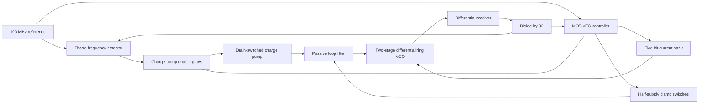

# Architecture

The PLL separates coarse frequency selection from analog fine tuning. During AFC, a five-bit current-bank code selects the ring VCO's band while two MOS transmission gates hold the loop-filter nodes near half the supply. After a tested candidate is accepted, the code remains fixed and the analog loop performs final acquisition.



The receiver converts the VCO waveform into the signal required by the physical divider. The feedback signal used for analog-loop evaluation is the actual divided VCO output. The AFC uses a separately gated version of that signal for its measurement epoch.

## Two-phase frequency detection

The detector uses the 100 MHz reference and its inverse. The first eligible gated feedback edge captures the reference level and selects which phase acts as lead and which acts as lag. The adjacent original reference edges are separated by half a reference period, or 5 ns. This preserves a two-phase bracketing idea from the 2009 design, but uses a different phase generator.

Three eight-bit registered Gray counters count lead, lag, and feedback edges. Their words pass through matched two-stage synchronizers into the reference domain and are decoded for comparison. Matched pipelines reduce an obvious comparison-age mismatch; they do not guarantee identical sampling age under every clock relationship. Gray coding does not eliminate metastability.

The ring current-bank polarity in the tested region is:

```text
C_lag - C_div >= 2   -> feedback too slow -> increase coarse code
C_div - C_lead >= 2  -> feedback too fast -> decrease coarse code
```

A direction requires two consecutive qualifying observations. Large frequency errors can therefore terminate a measurement early. If no qualified direction appears before the lag count reaches 128, the result is treated as a near candidate. That is a coarse-search decision, not a guarantee that the final 3.2 GHz lock criteria already hold.

The ideal initial-credit contract is lead = 1, lag = 0, feedback = 0, with the first eligible feedback edge incrementing feedback to 1. Saved nominal edge brackets support the phase selection in the completed run. They do not independently establish every native counter's first increment, internal setup/hold margin, reset propagation, arbitrary initial-phase behavior, or metastability probability.

## Search and state control

The search starts at code 16 and uses step magnitudes 8, 4, 2, and 1. It tests at most five candidates and retains a code that was actually measured. The successful full run followed:

```text
Code:       16     24     28     30     29
Decision:   SLOW   SLOW   SLOW   FAST   NEAR
```

The main sequencing rules are:

| Stage | Behavior |
| --- | --- |
| SETTLE | Wait four reference cycles after a code change; hold the measurement counters in reset. |
| ARM | Establish a fresh first-feedback epoch and reference-phase selection; fail safely if feedback does not arrive within the 32-cycle watchdog. |
| MEASURE | Observe synchronized counts, qualify the direction, or accept the finite near window; a 192-cycle watchdog bounds the measurement. |
| DRAIN | Preserve the frozen decision counters for two reference cycles before advancing. |
| DONE | Keep the selected code and wait two control-clock edges before enabling the fine loop. |
| FAIL | Retain the safe failed state and prevent analog handoff. |

Terminal results at the search endpoints describe failure to find a suitable candidate under the held-control condition. They do not prove that the entire analog tuning range is incapable of the target frequency.

The selected R1 AFC contains 7,135 MOS instances and 146 resettable transmission-gate DFF instances, plus a feedback-enable latch. Its static CMOS gates, clock interlocks, nonoverlap guards, buffers, synchronization words, frozen snapshots, comparison logic, and fault control contribute to that size. It is an inspectable baseline rather than a demonstrated minimum-area implementation.

## Analog hold and handoff

During AFC, the PFD is reset and charge-pump control is gated off. A 20 kohm / 20 kohm divider supplies the nominal 0.6 V hold level. Two physical transmission gates connect that level to the loop-filter nodes. The selected stronger-clamp bench uses 10 pF at the hold reference and 16 um NMOS / 32 um PMOS widths for each clamp, with 0.13 um channel length.

The earlier weak-clamp bench used 1 pF and 4 um / 8 um clamp widths. It completed coarse search and fine acquisition, but exceeded the predefined 30 mV hold-error limit. The stronger-clamp change retained the same R1 controller, search settings, acceptance criterion, and numerical settings. Its measured maximum held error was 19.312722 mV.

After DONE, the clamps release and the charge pump resumes operation with the coarse code fixed. The fine-loop control voltage undergoes a substantial transient excursion after handoff and needs about 1.118599 us to meet the engineering lock criteria. Handoff is functional in the measured case; it has not been shown to be disturbance-free or to improve physical jitter.

## Implementation boundary

The controller is built from MOS circuits, including its counters and state storage. The complete bench also contains physical VCO, receiver, divider, PFD, charge pump, and clamp circuits. External clock generation, bias generation, passive-component nonidealities, and robust cold start are not fully implemented here.

Observable controller and gated-feedback activity stops after the handoff in the saved nominal evidence. Some reference-related diagnostic activity remains. The evidence does not show that every internal clock stops, and the AFC supply branch has nonzero tail power.
